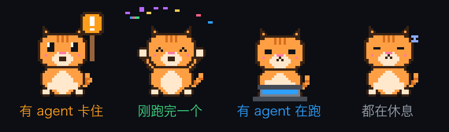

# miband pet

<p align="center"></p>

<p align="center"></p>

让小米手环 10 Pro 变成 AI agent 的状态宠物：Mac 通过蓝牙直连手环（不经过手机），把 [herdr](https://herdr.dev) 管理的 agent 状态显示在手环上。

手环上只装一个通用的渲染器（`render-app/`），显示的界面都是插件，一次显示一个，在 App 里切换。插件用 JSX 写，由 Mac 编译后推到手环、在手环本地跑；Mac 负责推数据（agents、设置）：

- **Agent 猫**（`server/plugins/agent-cat/`）：一只像素猫代表所有 agent 的整体状态，可以在 App 里换成橘猫、灰猫（中华田园猫）或白猫（美短）。有 agent 卡住了它举牌，跑完一个就庆祝，有在跑的就敲笔记本，都空闲时睡觉。
- **Agents 列表**（`server/plugins/agents/`）：按状态排序，列出每个 agent 的项目和任务，上下滑翻页。
- **小鱼干**：agent 每跑完一个任务得一条小鱼干，在猫页面点右下角喂猫；**今日**（`server/plugins/today/`）显示今天完成了几个、最近 7 天的柱状图。agent 卡住太久（默认 5 分钟），猫会着急，Mac 再提醒一次。
- **额度**：猫页面标题下显示最紧的那项额度，今日页显示全部。Codex 的直接从会话日志读；Claude Code 的要在 App 里打开「显示 Claude Code 额度」（接管状态栏命令拿数据，原来的状态栏照常显示，关掉原样还原）。
- **自己写插件**：用 JSX 写一个组件放进插件目录，保存就出现在手环上，不用重装手环上的应用。见 [docs/plugins.md](docs/plugins.md)。
- **通知**：agent 开始跑、跑完、卡住时，手环震动提醒。

> 非小米官方项目。用的是逆向出来的非官方协议（移植自 Gadgetbridge、OronBox），风险自负。许可证 AGPL-3.0，致谢见 [NOTICE.md](NOTICE.md)。

## macOS App（server/app/）

日常用 App 就行：打开后在后台连手环、跑插件，窗口里能看到和手环同步的猫、agent 列表、提醒设置、插件列表，也能一键安装或更新手环上的渲染器（安装包已打包进 App）。

```sh
make app      # 生成 server/app/build/bin/miband pet.app
```

- Wails v2 + React，界面跑在系统自带的 WKWebView 里，不带 Chromium。
- 第一次打开会进入**连接向导**：
  1. 借用手机，用小米运动健康绑定一次手环（手环的密钥是绑定时生成的，之后就不用手机了）；
  2. 在 App 里扫码登录同一个小米账号，自动拿到手环的密钥和地址；
  3. 在手机系统蓝牙里对手环「取消配对」（不要在小米运动健康里解绑），再在手环上进入「连接新手机」停在二维码界面，App 会自动通过 BLE 连上手环，两边弹出配对确认时点允许；
  4. 一键把渲染器「miband pet」装到手环上。以前装过的旧版「Agent 猫」「Agents」会显示在「手环上的应用」里，可以卸载。

  换手环或手环重新绑定过，点「换手环 / 重新绑定」重走一遍；登录态有缓存，一般不用再扫码。
- 连接方式：日常走经典蓝牙；连不上（比如手环在「连接新手机」界面）会自动扫描 BLE 再连，之后优先用上次成功的方式。
- 配置和登录态在 `~/Library/Application Support/miband-pet/`（`config.json`、`session.json`，权限 600）。
- 关掉窗口后 App 留在菜单栏继续推送（菜单栏的猫头图标），从菜单栏「退出」才会真正退出。
- **签名**：macOS 按“App 标识 + 签名证书”记蓝牙授权。没签名的话每次构建签名都变，每次都会重新弹蓝牙授权。`make app` 会用钥匙串里名为 `miband pet local signing` 的证书签名，建一次即可：

  ```sh
  openssl req -x509 -newkey rsa:2048 -keyout key.pem -out cert.pem -days 3650 -nodes \
    -subj "/CN=miband pet local signing" -addext "keyUsage=critical,digitalSignature" \
    -addext "extendedKeyUsage=critical,codeSigning" -addext "basicConstraints=critical,CA:false"
  openssl pkcs12 -export -legacy -inkey key.pem -in cert.pem -out cert.p12 -passout pass:tmp
  security import cert.p12 -k ~/Library/Keychains/login.keychain-db -P tmp -T /usr/bin/codesign
  rm key.pem cert.pem cert.p12
  ```
- App 和命令行版不要同时运行：手环同一时间只接受一个连接。

## 后端服务（Go，server/）

日常用的是 Go 写的 `server/miband`，蓝牙也在里面（cgo 调 macOS IOBluetooth 开经典蓝牙 RFCOMM）：

```sh
cd server && go build -o miband ./cmd/miband && cd ..
server/miband app                 # 常驻：跑插件、把界面推给手环；agent 跑完/卡住时发通知
server/miband notify 标题 正文     # 发一条通知
server/miband apps                # 列出手环上的快应用
server/miband launch [包名]        # 把快应用打开到前台（默认渲染器），手环会亮屏
server/miband key                 # 扫码登录小米账号，拉手环的 auth key 和地址写进 ./config.json
server/miband install render-app/dist/dev.bysir.mibandpet.debug.*.rpk
```

配置读 `./config.json`（或用 `-config` 指定）。agent 开始跑、跑完、卡住时会提醒手环：

- `"alert"`：提醒方式。`"auto"`（默认）：手环上渲染器正在显示时只亮屏、不震动，否则发通知震动；`"wake"` 总是把渲染器打开到前台并切到猫（亮屏不震动）；`"notify"` 总是发通知；`"both"` 两者都要。
  渲染器在前台时会给 Mac 发 `hello`，离开时（右滑退出、熄屏后回到表盘）发 `bye`，Mac 据此判断。
- `"notify_start": false`：开始跑时不提醒，只在跑完、卡住时提醒。
- `"notify": false`：完全不提醒（手环上的界面照常更新）。

- `internal/bt/`：RFCOMM 桥接。IOBluetooth 的回调只投递到主线程，所以 `main` 里调 `bt.RunMain`，主线程常驻 run loop。
- `internal/xiaomi/`：协议（SPP v2 帧、鉴权、AES-CCM/CTR、停等发送、通知、快应用安装和消息）。`go test ./...` 里有个模拟手环做端到端测试，加密结果用 `testdata/vectors.json` 和原 Python 实现对照。
- `internal/herdr/`：读 `herdr agent list`、算状态变化事件。
- `internal/plugin/`：插件宿主。esbuild 编译插件，按哈希把代码、图片推给手环，推数据；用户插件改了自动重新编译。测试里用 goja 跑手环上的同一份运行时。
- `plugins/`：内置插件（Agent 猫、Agents 列表），打包进 App。

踩过的坑：
- **要用异步的 `openRFCOMMChannelAsync`**。手环会把 Mac 当成自己的手机主动连上来，这时同步的 `openRFCOMMChannelSync` 会误报 `kIOReturnError`（系统日志里通道其实已经连上），看起来就像“要重启手环才能连”。
- 也不能在派发到主队列的块里等这个回调（回调同样走主队列，会死锁）；结果通过 cgo 回调通知 Go。
- 通道没关就退出会让手环那边卡住，所以程序退出前一定关通道。

Python 版（`main.py`、`get_key.py` 等）是最早的实现，留作参考（它的快应用模式推的是改成插件之前的旧格式）；画猫的 `tools/gen_pet.py` 仍用 Python。

## 准备（以手环 10 Pro 为例，实测可用）

1. 手机上用小米运动健康扫手环的绑定二维码，正常绑定一次。这是唯一需要手机的一步。
2. 拉 key：在 App 里扫码登录，或者用命令行 `server/miband key`。它从小米健康云拉设备的 `encrypt_key`，连同 MAC 写进配置；登录态有缓存，下次不用再扫码。（`get_key.py` 是早期的 Python 版，留作参考。）
3. 让手环脱离手机：在手机**系统蓝牙**里取消配对手环，再关掉手机蓝牙。不要在 App 里解绑，解绑后 key 会作废。
4. 首次接管：手环停在「连接新设备」的二维码界面时会广播 BLE，跑 `transport: "ble2"` 连一次，鉴权成功后 Mac 会和手环完成系统层配对。
5. 之后把 `transport` 改成 `spp`（经典蓝牙），日常都走这个。连不上时重启一次手环。

几个小知识：
- 手环 10 系列不回应 SPP v1 的版本探测包，代码超时后会直接开 v2 会话。
- 账号密码登录（huami-token）会被小米的二次验证拦下，所以 `get_key.py` 改用扫码登录。
- 小米运动健康 3.59 版的日志里已经没有 key 了。

## 使用

```sh
python3 -m venv .venv && .venv/bin/pip install bleak cryptography protobuf pyobjc-framework-IOBluetooth \
    git+https://github.com/argrento/huami-token   # get_key.py 要用
protoc -Iproto --python_out=. proto/xiaomi.proto proto/vela.proto   # 改了 proto 才需要重新生成

.venv/bin/python main.py scan                 # 找手环，地址可以填进 config.json 的 address，省掉每次扫描
.venv/bin/python main.py notify 你好 测试      # 发一条通知试试
.venv/bin/python main.py watch                # 常驻，监听 herdr
```

`watch` 每 3 秒跑一次 `herdr agent list`，agent 从 working 变成 done/idle，或者变成 blocked 时推送通知；断线后每 15 秒重连一次，没发出去的通知等重连后补发。

第一次运行时 macOS 会请求蓝牙权限，授权对象是你用的终端 App。

## 手环上的渲染器（render-app/）

手环端是一个 Vela JS 快应用，本身不带任何界面：Mac 把编译好的插件代码推过来，它用 `new Function` 加载，插件在手环上跑（hooks 运行时在 `src/common/runtime.js`），点击、翻页都在本地处理。写法见 [docs/plugins.md](docs/plugins.md)。

- 快应用的模板是编译时定死的，所以 `src/pages/index/index.ux` 里把 6 层嵌套都写了出来，由 `tools/gen_template.py` 生成；节点树的格式和消息协议写在这两个文件的开头。
- 图片（比如猫的帧）由 Mac 按内容哈希推过来，写进 `internal://files/`，推过就不再推。动画用 `image-animator` 在手环本地播。
- 能不能这么做、有哪些限制（单条消息不超过 16KB、新建节点约 10ms 一个、JS 引擎支持到 ES2020），是先做实验在真机上量出来的，见 [docs/render-spike.md](docs/render-spike.md)。
- 手环只支持 png/jpg，不支持 GIF 和视频。

```sh
cd render-app && npm install && npx aiot build && cd ..   # 打包成 dist/*.rpk
server/miband install render-app/dist/dev.bysir.mibandpet.debug.*.rpk
```

安装和消息协议参考 OronBox（`vela.py` 文件头有说明）：先 `PREPARE_INSTALL_APP`，再 MASS prepare，分片走明文的 mass 通道，靠 SPP v2 的 ACK 做确认，最后等 `REPORT_INSTALL_RESULT`。给快应用发消息要带包名和签名指纹，指纹从 `GET_INSTALLED_LIST` 拿；快应用打开时会来问「手机端在不在」，要回 `SYNC_PHONE_APP_STATUS=CONNECTED`，否则 interconnect 不会触发 onopen。

## Agent 猫

用一只像素猫表现 agent 的整体状态：有卡住的举牌摇晃，刚完成一个就庆祝 8 秒，有在跑的就敲笔记本，否则睡觉。气泡里显示最值得关注的 agent，点猫或气泡切换。

- 素材由 `tools/gen_pet.py` 生成到 `server/plugins/agent-cat/assets/`：猫是一张逐像素手绘的字符格子图（40×40 像素网格放大 4 倍），三种猫共用格子图和动作帧，只换配色（`SKINS`）；改形象只改这个脚本再重新生成，怎么画、踩过哪些坑见 [docs/pixel-cat.md](docs/pixel-cat.md)。`make app` 会把帧同步到 Mac App 里。
- 换猫：Mac App 里选，手环上马上换（没推过的帧会推过去，一只猫约 23KB）。

```sh
.venv/bin/python tools/gen_pet.py [预览图.png]   # 重新生成帧
```

## 文件

- `miband.py`：协议层（鉴权 HKDF + AES-CCM、对时、发通知）和 BLE 传输
- `spp.py`：经典蓝牙 SPP v2 传输（IOBluetooth RFCOMM，帧带 CRC16，AES-CTR 加密）
- `vela.py`：快应用的安装、启动、收发消息
- `main.py`：命令行入口、herdr 监听（通知模式 `watch` / 快应用模式 `app`）
- `render-app/`：手环上的渲染器；`server/plugins/`：内置插件
- `xiaomi_pb2.py` / `vela_pb2.py`：由 `proto/` 下的 proto 生成
